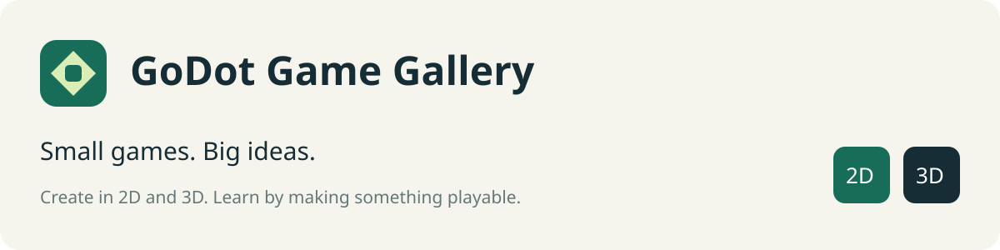

# GoDot Game Gallery

### Small games. Big ideas.

A local-first game workshop for learning to program. Make independent **2D and 3D Godot games**, keep each one in its own folder, and play them from an automatically discovered **4 × 2 paginated gallery**.



**macOS + Linux · Godot 4.7.2 · GDScript · Python 3.11+ · MIT**

## Play in three commands

Install [Python 3.11 or newer](https://www.python.org/downloads/), then open a terminal in this repository:

```sh
python3 ggg.py setup
python3 ggg.py doctor
python3 ggg.py gallery
```

`setup` downloads the official standard Godot editor for your computer and verifies its SHA-256 against `engine.lock.json`. The engine stays inside this repository's ignored `.tools` folder. No pip installation, account, or cloud service is required to create or play games. After setup, everyday development works offline.

Linux supports x86_64 and ARM64 development machines. macOS uses the universal Intel/Apple Silicon editor. A graphical desktop and OpenGL-compatible graphics are required for normal play. Source games also open directly in Godot.

Already installed Godot? Set `GODOT_BIN` to its executable; its version must match the lock file. On a Mac the executable is inside `Godot.app/Contents/MacOS/Godot`.

## Make your first game

```sh
python3 ggg.py new moon-jumper --dimension 2d --title "Moon Jumper"
python3 ggg.py play moon-jumper
python3 ggg.py edit moon-jumper
```

Open `games/moon-jumper/player.gd` in your favorite code editor. Change `speed` or `jump_speed`, save, and run the game again. Refresh the gallery with **F5** to see newly created games. Choose `--dimension 3d` for a floating-island starter.

**Your changes belong to your game.** Templates are copied, not linked. Editing a game cannot change the starter template or another game's code.

## Included games

| Game | Explore | First experiments |
| --- | --- | --- |
| **Coin Garden · 2D** | Jump across platforms and collect six sun coins | Change jump height, rearrange coins, add a platform |
| **Sky Steps · 3D** | Hop between floating islands and collect six sky sparks | Move an island, change gravity, add a spark |
| **Pong · 2 Players · 2D** | Rally on one keyboard; first to seven wins | Tune ball speed, change paddle size, experiment with bounce angles |

Coin Garden and Sky Steps have movement, jumping, collisions, and a win state. Falling in Sky Steps returns you to the starting island while retaining collected sparks. Pong gives Player 1 **WASD** and Player 2 the **arrow keys**, with **Space** to serve or pause. Every game supports **R** to restart and **Esc** to return to the gallery. See [Pong's controls and learning experiments](games/pong/README.md).

The gallery includes search, 2D/3D filters, keyboard focus, eight slots per page, empty slots for future ideas, and automatic return when a game closes. Games run in separate processes. Invalid manifests are skipped with a visible message; `check` explains the problem.

## Commands

| Command | What it does |
| --- | --- |
| `python3 ggg.py setup` | Install the pinned Godot editor |
| `python3 ggg.py setup --templates` | Also install export templates; approximately 1.3 GB extra |
| `python3 ggg.py doctor` | Check the environment and manifests |
| `python3 ggg.py list` | List automatically discovered games |
| `python3 ggg.py gallery` | Open the game gallery |
| `python3 ggg.py new NAME --dimension 2d` | Copy a playable starter into a new folder |
| `python3 ggg.py play NAME` | Run a source game immediately |
| `python3 ggg.py edit NAME` | Open a game's Godot editor |
| `python3 ggg.py check` | Validate game metadata and files |
| `python3 ggg.py check --smoke` | Import and exercise the gallery, games, and templates |
| `python3 ggg.py build --platform linux` | Export a portable Linux x86_64 collection |
| `python3 ggg.py build --platform macos` | Export a portable universal macOS collection |

## How folders become games

Each immediate folder inside `games/` containing a valid `game.json` is a game. Its folder name matches its manifest ID. A source game contains `project.godot`, scripts, a scene, its own artwork, and its manifest. No central registry needs updating.

The gallery reads metadata and artwork from disk at startup and when refreshed. Source mode launches the pinned Godot engine with the selected project's path. Exported mode launches that game's native executable. **Creating source folders adds development games; adding games to a distributed bundle requires exporting them.**

See [the manifest contract](docs/architecture.md#manifest-contract) and its [editor schema](schema/game.schema.json).

## Build and share

```sh
python3 ggg.py setup --templates
python3 ggg.py build --platform linux
python3 ggg.py build --platform macos
```

Outputs go to `dist/linux/` and `dist/macos/`. Keep the `games` folder beside the launcher. Players need neither Python nor a Godot installation. Exports are **unsigned local builds**; [distribution notes](docs/distribution.md) explain Mac signing and what has been tested.

The manual **Build playable bundles** GitHub Actions workflow produces downloadable archives after this repository is hosted on GitHub. The regular checks workflow validates code on Linux and imports/smoke-tests projects on Linux and macOS. Workflows are provided; a successful remote CI run is not implied by their presence.

## Develop the platform

```sh
python3 -m venv .venv
. .venv/bin/activate
python -m pip install -r requirements-dev.txt
ruff check .
ruff format --check .
gdformat --check launcher templates games tools/*.gd
python -m unittest discover -s tests -v
python ggg.py check --smoke
```

The Python tools use only the standard library at runtime. Development dependencies are pinned. GitHub Actions are pinned to commit SHAs, permissions are read-only, and Dependabot proposes updates.

## Read next

- [Learning trail: small experiments in 2D and 3D](docs/learning.md)
- [Architecture and project boundaries](docs/architecture.md)
- [Testing and verification](docs/testing.md)
- [Builds and distribution](docs/distribution.md)
- [Contributing](CONTRIBUTING.md)
- [Research references and licensing](docs/references.md)
- [First-version boundaries and next milestones](docs/roadmap.md)

All included scripts and artwork are original implementations, released under [MIT](LICENSE). Godot has its own license and third-party notices, included with its official distributions.
