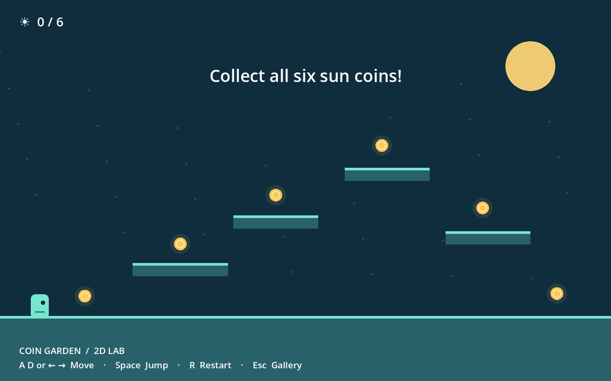
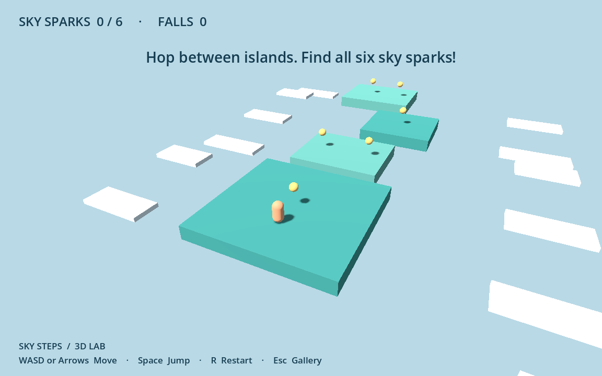

# A trail of small experiments

Work on one change at a time. Predict what it will do, run the game, and describe what actually happened. Keep a copy or Git commit of something working before a bigger experiment.

## Coin Garden · 2D

| Experiment | Where | Programming idea |
| --- | --- | --- |
| Double walking speed | `player.gd`: `speed` | Variables and units |
| Make jumping floaty | `jump_speed` and `gravity` | Cause and effect; velocity |
| Add a seventh coin | `main.gd`: `COIN_POSITIONS` | Arrays and loops |
| Move a platform | `_ready()` platform rectangles | Coordinates and collision shapes |
| Change the victory message | `_check_pickups()` | Conditions and state |
| Add a moving hazard | A new node and a position update | Time, functions, and interactions |

Coins are collected using distance checks. Platforms use actual physics bodies. Ask why these two interactions use different approaches.

## Sky Steps · 3D

| Experiment | Where | Programming idea |
| --- | --- | --- |
| Make islands wider | `_build_world()` → `_island()` | Three-component vectors |
| Add a sky spark | `STARS` | Collections and object creation |
| Make jumps higher | `player.gd`: `jump_speed` | Vertical velocity and gravity |
| Change the camera angle | Camera offset in `_physics_process()` and `_respawn()` | Viewpoints and interpolation |
| Add an island | Another `_island()` call | Reusing functions |
| Add a checkpoint | Store a position and update `_respawn()` | Persistent state |

The camera is deliberately fixed at an angle and follows the player. There is no mouse capture to learn before moving around. All geometry and artwork are made in code, so the first experiments need no asset pipeline.

## Your own game

1. Create a starter with `python3 ggg.py new my-game --dimension 2d`.
2. Change its title and description in `game.json`.
3. Change one rule: collect, dodge, race, or explore.
4. Draw a thumbnail by editing `tile.svg`, or replace it with your own PNG and update the manifest.
5. Run `python3 ggg.py check` and refresh the gallery.
6. Explain the rule to someone and watch them play.

For a concept refresher, try [GDQuest's Learn GDScript From Zero](https://gdquest.github.io/learn-gdscript/). Its lessons complement editing real games. It is optional and separate from this repository.

## Endless Tower · procedural climbing

[Open the tower guide](../games/endless-tower/README.md), then try changing one biome palette, adding a family to `biomes.gd`, or tuning acceleration in `player.gd`. Compare the same seed before and after a layout change. Keep adjacent floors reachable and run the smoke checks before trying a long climb.
