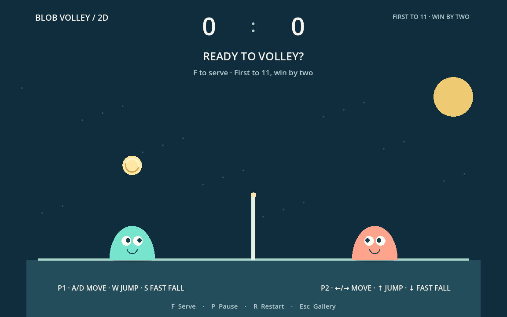

# Blob Volley 2D



An original, local two-player volleyball game inspired by the simple blob-and-ball idea of Blobby Volley. All characters, artwork, rules code, and meshes here are original; no assets or source were copied from that game.

```sh
uv run ggg play blob-volley-2d
```

| Control | Action |
| --- | --- |
| Player 1 | A/D move, W jump, S fast fall |
| Player 2 | Left/right move, up jump, down fast fall |
| F | Start the first serve |
| P | Pause/resume, including the between-point countdown |
| R | Restart the whole match |
| Esc | Return to the gallery |

Move under the ball and jump to head it over the net. Contact is automatic. Each player stays on their own half. First to **11 points with a two-point lead** wins. A ball landing on your half awards the opponent a point. Hitting out of bounds or taking a fourth consecutive touch also loses the point. The point winner serves after a short break.

This classic side view locks depth to zero. Hold S or Down during a jump to fall faster.

## Learn by changing a rule

- `rules.gd` owns movement, gravity, substep collision, scoring, serves, and deuce.
- Change `MOVE_SPEED`, `JUMP_SPEED`, or `WINNING_SCORE` for a different pace.
- Change `_hit()` to experiment with the ball's launch angle and speed.
- `controls.gd` maps the keyboard; `hud.gd` displays scores and instructions.
- `main.gd` draws the court and characters from the rule state.
- `smoke.gd` exercises controls, jumping, head contact, net collisions, scoring, the three-touch limit, and win-by-two matches.

The 2D and 3D folders each own an independent copy of their rules and helpers. Editing this game cannot change the other version. They start with the same rules so it is easy to compare coordinates and rendering between dimensions.
