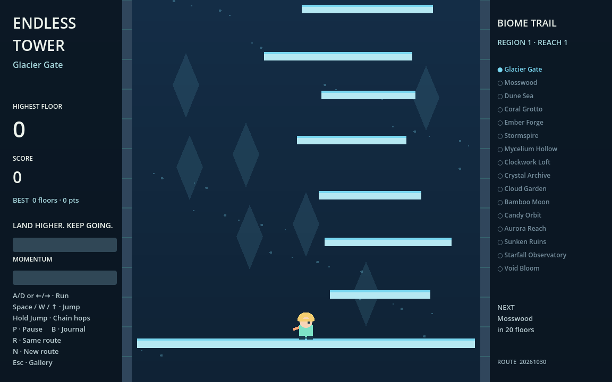
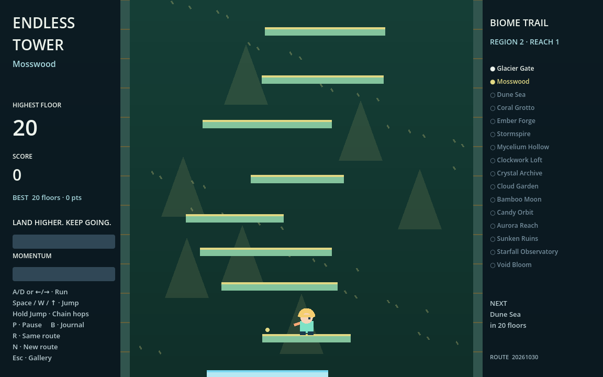
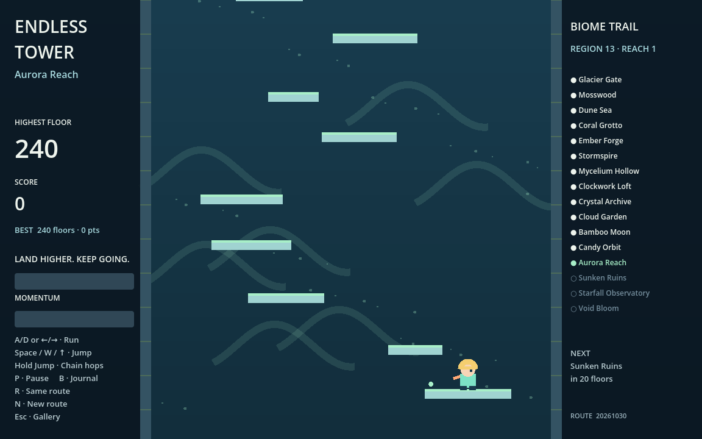

# Endless Tower

An original 2D momentum climber inspired by Icy Tower's run, jump, and keep-climbing idea. The character, artwork, generator, biome system, and scripts are original; no Icy Tower assets or source code are used.

```sh
python3 ggg.py play endless-tower
```



## Controls

| Control | Action |
| --- | --- |
| A/D or left/right arrows | Build horizontal momentum |
| Space, W, or Up | Jump; hold to automatically hop after landing |
| P | Pause/resume |
| B | Open/close the biome journal; gameplay freezes while it is open |
| R | Restart the same seeded route |
| N | Start a new seeded route |
| Esc | Save records and return to the gallery |

Speed gives higher jumps. Walls reflect horizontal momentum. Platforms are one-way: pass through them from below, then land on top. A short jump buffer and coyote window make timing forgiving. The camera begins rising after your first jump and gradually speeds up; fall below the screen to end the run. Time spent reading the intro does not increase difficulty.

Landing on new higher floors scores points. Chain landings within 2.5 seconds to build a multiplier, up to ×8; revisiting old floors cannot farm points. The altitude record measures the highest point you actually reach, while scoring requires a landing.

## A tower of changing worlds

Every **20 floors**, discover another biome. The first tour contains **16 authored families**:

| Family | Atmosphere and gentle movement changes |
| --- | --- |
| Glacier Gate | Crystals, snow, slippery footing |
| Mosswood | Forest silhouettes and falling leaves |
| Dune Sea | Dunes, sand, and a gentle breeze |
| Coral Grotto | Bubbles, reef shapes, and extra lift |
| Ember Forge | Volcanic silhouettes, embers, and extra lift |
| Stormspire | Clouds, rain, wind, and slick footing |
| Mycelium Hollow | Mushrooms, spores, and extra lift |
| Clockwork Loft | Slow-turning gears and sparks |
| Crystal Archive | Crystal silhouettes and slippery footing |
| Cloud Garden | Clouds, petals, a breeze, and extra lift |
| Bamboo Moon | Segmented stalks and drifting leaves |
| Candy Orbit | Pastel planets and extra lift |
| Aurora Reach | Waving ribbons, snow, and a breeze |
| Sunken Ruins | Pillars, bubbles, and extra lift |
| Starfall Observatory | Constellations, stars, and extra lift |
| Void Bloom | Orbiting forms, spores, and a breeze |

After floor 320, the climb continues through **remixed reaches**: new region names, hue-shifted palettes, and increasing reach numbers. There is no final biome or fixed final floor. These are procedural variations of the 16 families, rather than a claim of infinitely many hand-drawn environments. The sidebar previews the next discovery; B opens a journal of the latest reached regions. Your highest floor keeps discoveries available between runs.




## Records, routes, and generation

Best altitude and score are stored locally in this game's `user://tower_save.cfg`; they are saved on game over, retry, Esc, or window close. No account or network access is needed. R repeats the displayed route seed; N changes it. Physics and artwork need no assets outside this game folder.

Generation now uses seeded randomness rather than a sine-wave staircase. Individual widths and horizontal positions vary, and vertical rises fluctuate between roughly **62 and 106 pixels**. The average width decreases by biome level: about **220 px initially, 166 px at level 5, 134 px at level 9, and 102 px at level 17**, gradually approaching an 84 px mean. Individual widths vary by up to 28% around that mean, so a later wide landing can still provide a breather.

Each proposed step is checked against a numerical jump model using the real character's gravity, acceleration, and baseline jump. It starts from rest, excludes momentum/biome bonuses, checks still air and both maximum wind directions, and reserves room to brake on the landing. Platforms can have genuine horizontal gaps; overlap is no longer required. Eight representative transfers are also tested with the real Godot character.

Twenty-floor chunks connect through validated boundary platforms, and an eight-chunk cache keeps distant generation cheap. The camera, altitude counter, streaming, and biome discovery use the generated floor heights instead of assuming fixed spacing. See [the algorithm and research notes](GENERATION.md).

**Route format v2:** R still repeats the current seed exactly, but seeds from the earlier sine-wave generator now produce the new layout. Existing local records are retained.


## Learn by changing a rule

- `player.gd`: acceleration, friction, gravity, coyote time, wall bounce, and momentum-powered jumps.
- `layout.gd`: seeded chunk sampling, smaller level means, varied heights, and validated connections.
- `jump_model.gd`: the jump witness and air-braking controller; motion constants come from `player.gd`.
- `biomes.gd`: add a biome family or change its palette, weather, and movement values.
- `main.gd`: camera pressure, platform streaming, combos, records, journal, and code-drawn artwork.
- `smoke.gd` and `layout_smoke.gd`: movement checks, 15,000 simulated jump edges, eight real-engine transfers, width/height statistics, 1,024 region identities, cache/streaming bounds, pause, failure, and replay.

The game is designed as a learning project. Automated checks do not replace a human playtest of the difficulty curve. Native Mac play and native exports have not been verified for this addition.
